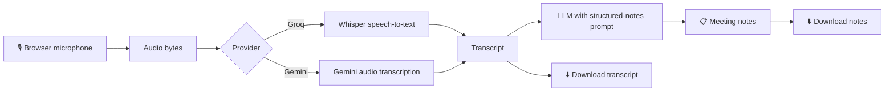

# 🎙️ AI Meeting Summarizer

**Record a meeting. Get a transcript, decisions, and action items in seconds.**

🔗 **Live demo:** `https://hijab-meeting-summarizer.streamlit.app/`
      Demo Video: https://drive.google.com/file/d/1zN2C3zRSZhpqgezcN_LRoq6ECg-1v4z4/view?usp=drivesdk


---

## 📌 The Problem

Meetings are where decisions get made, but most of what is said is lost the moment the call ends.

- People are busy **taking notes instead of participating**.
- Notes are **incomplete, inconsistent, or never written at all**.
- **Decisions and action items get forgotten**, and nobody is sure who owns what or when it is due.
- Reading a full recording or raw transcript later is **slow and rarely done**.

The result is repeated meetings, missed deadlines, and wasted time.

## 🎯 The Purpose

To make every meeting **actionable**: let people focus on the conversation while software captures what was said and turns it into clear, structured notes that anyone can act on.

## 💡 The Solution

**AI Meeting Summarizer** is a web app that turns a spoken conversation into professional meeting notes in three steps:

1. **Record** audio directly in the browser with one click.
2. **Transcribe** the speech to text using AI speech recognition.
3. **Summarize** the transcript into structured notes with an LLM.

The notes always follow the same format:

| Section | What it gives you |
|---|---|
| **Executive Summary** | The meeting in a few sentences |
| **Key Discussion Points** | The main topics covered |
| **Decisions Made** | What was agreed |
| **Action Items** | Task, owner, and deadline |
| **Unresolved Questions** | What still needs an answer |

## ✨ Key Features

- 🎙️ **One-click browser recording**, with no extra software needed
- 📝 **Accurate AI transcription** of the full conversation
- 📋 **Structured notes** with decisions and action items
- 🛡️ **Anti-hallucination prompt**: the AI may only use information from the transcript and must write *"Not specified"* instead of inventing owners, decisions, or deadlines
- 🔀 **Choice of AI provider**: Groq or Google Gemini, switchable from the sidebar
- 🔑 **Bring your own key**: paste an API key in the sidebar, or use a server-side key
- ⬇️ **Download** the audio, the transcript, and the meeting notes
- 🧯 **Clear error messages** and a built-in "Test key / list models" button for easy troubleshooting
- 💸 **Runs on free-tier APIs**, so no paid subscription is needed

## 🏗️ How It Works



## 🧠 AI Methodology & Model/API Usage

The app uses a **two-stage AI pipeline** built entirely on hosted models accessed through their official APIs. No models were trained or fine-tuned, and no data is stored by the app.

### Stage 1: Speech-to-text (transcription)

| Provider | Model | Role |
|---|---|---|
| Groq | `whisper-large-v3-turbo` (OpenAI Whisper) | Converts recorded audio into a text transcript |
| Google Gemini | `gemini-3.5-flash` (multimodal audio input) | Alternative transcription, prompted to return only the exact spoken words |

### Stage 2: Structured note generation (LLM)

| Provider | Model | Role |
|---|---|---|
| Groq | `openai/gpt-oss-120b` | Turns the transcript into structured meeting notes |
| Google Gemini | `gemini-3.5-flash` | Alternative note generation |

### Prompt design (how we keep the output reliable)

- **Role prompting:** a system prompt makes the model act as an expert meeting assistant.
- **Fixed output structure:** the prompt requires five sections (Executive Summary, Key Discussion Points, Decisions Made, Action Items, Unresolved Questions), so results are consistent across meetings.
- **Grounding / anti-hallucination rules:** the model may only use information supported by the transcript, must never invent owners, decisions, or deadlines, and must write **"Not specified"** when a detail is missing.
- **Two separate calls:** transcription and summarization are separate steps, so the raw transcript can always be checked against the generated notes.

### API usage notes

- Keys are read from environment variables or Streamlit Secrets and are never hard-coded or committed to the repository.
- Users can paste their own key in the sidebar, and it is used only for the current session.
- Model names are editable in the sidebar, because providers retire models over time. A **"Test key / list models"** button shows which models an account can use.

## 🖼️ Screenshots

| Home & recording | Transcript | Structured notes |
|---|---|---|
|  |  |  |

## 🧰 Tech Stack

| Layer | Technology |
|---|---|
| Interface | [Streamlit](https://streamlit.io) |
| Audio capture | `streamlit-mic-recorder` |
| Speech-to-text | Whisper on Groq, or Google Gemini |
| Note generation | LLMs via the Groq API or the Google Gemini API |
| Language | Python |
| Deployment | Streamlit Community Cloud |

## 🚀 Run It Locally

**1. Clone the repository**
```bash
git clone https://github.com/<your-username>/<your-repo>.git
cd <your-repo>
```

**2. Install dependencies**
```bash
pip install -r requirements.txt
```

**3. Add your API key** (free keys: [Groq Console](https://console.groq.com) or [Google AI Studio](https://aistudio.google.com))

Create a file named `.env` in the project folder:
```
GROQ_API_KEY=gsk_your_key_here
# or
GEMINI_API_KEY=your_key_here
```
You can also skip this step and paste the key into the app's sidebar.

**4. Start the app**
```bash
streamlit run app_api.py
```

## ☁️ Deploy

1. Push this repo to GitHub (never commit your `.env` file).
2. Go to [share.streamlit.io](https://share.streamlit.io) and create a new app from the repo, with `app_api.py` as the main file.
3. Under **Advanced settings → Secrets**, add:
   ```
   GROQ_API_KEY = "gsk_your_key_here"
   ```
4. Click **Deploy**.

## 📖 How to Use

1. Choose a provider in the sidebar and (optionally) paste your API key.
2. Click **Start recording**, speak, then click **Stop recording**.
3. Click **Generate Transcript & Meeting Notes**.
4. Read the results in the **Raw Transcript** and **Structured Meeting Notes** tabs.
5. Download the audio, transcript, or notes from the bottom of the page.

## 🔒 Privacy & Limitations

- Audio is sent to the selected provider (Groq or Google) for processing, so avoid recording confidential meetings with a third-party API unless your policy allows it.
- Recordings are not stored by the app after your session ends.
- The app processes **one recording at a time** and does not yet identify individual speakers.
- Accuracy depends on audio quality, accents, and background noise.
- AI-generated notes should be reviewed before being shared as official minutes.

## 🛣️ Roadmap

- [ ] Speaker identification (who said what)
- [ ] Upload existing audio or video files
- [ ] Export notes to PDF, Word, or email
- [ ] Automatic task creation in tools like Trello or Notion
- [ ] Multi-language support and translation
- [ ] Fully offline mode using local models (Whisper and Ollama)

## 👥 Team & Contributions

| Team member | Role | Contributions |
|---|---|---|
| `<Your name>` | `<e.g. Developer>` | `<e.g. Built the Streamlit app, integrated Groq and Gemini APIs, wrote the prompts, deployed the app>` |
| `<Teammate name>` | `<Role>` | `<What they built or did>` |

<!-- Add or remove rows to match your team. Be specific about who did what. -->

## 📦 Submission Links

- **Working product:** `[AI Meeting Summarizer · Streamlit](https://hijab-meeting-summarizer.streamlit.app/)`
- **Demo video:** https://drive.google.com/file/d/1zN2C3zRSZhpqgezcN_LRoq6ECg-1v4z4/view?usp=drivesdk`
- **Repository:** https://github.com/hijabfatima-developer/Meeting-Summarizer-

---

*Built for `NYLP`. Because great meetings should lead to great action.*
